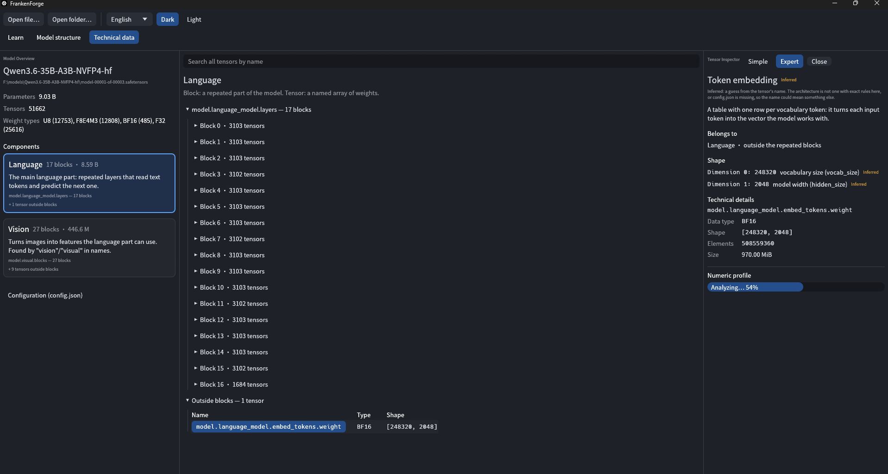
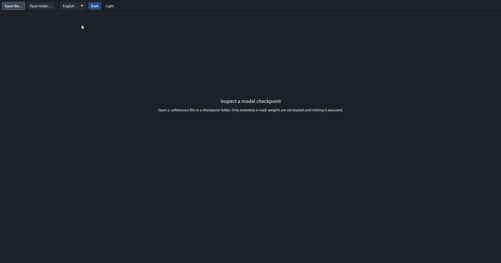

# FrankenForge

**Early prototype.** FrankenForge is a Rust toolkit for researching and recombining language-model
checkpoints — inspecting what is inside a model, transplanting blocks between models, and exporting
a rebuilt checkpoint whose bytes are verified on disk. No Python is involved anywhere.

The point of the project is twofold:

- **Make model architecture legible.** Most people who download a `.safetensors` checkpoint cannot
  say what is inside it. FrankenForge opens the file and explains its structure in plain language,
  in the reader's own language, without requiring any ML background.
- **Make experiments reproducible.** Every rebuild is described by a small TOML recipe, so the same
  experiment can be run again from the same inputs; after a build, a lock file records the SHA-256
  hashes of the recipe, every source model and the output so the result stays auditable. (A
  `--locked` rebuild that checks those hashes up front is not implemented yet.)

Nothing in the current prototype runs a model: opening a checkpoint reads only its headers and
metadata, surgery verifies file integrity, not model behavior. See [Limitations](#limitations).

### In one example: a block from SmolLM2-Instruct inside SmolLM2

[examples/smollm2-transplant.toml](examples/smollm2-transplant.toml) replaces block 15 of
SmolLM2-135M with block 15 of SmolLM2-135M-Instruct:

```toml
name = "smollm2-135m-block15-from-instruct"
base = "recipient"

[sources]
recipient = "../models/SmolLM2-135M"
donor = "../models/SmolLM2-135M-Instruct"

[[steps]]
op = "transplant"
from = "donor"
src = "model.layers.15."
dst = "model.layers.15."
```

`build` writes the model, re-reads every tensor and then explains what it made. This is the real
report (also saved as `<out>.report.md` and `<out>.report.json` next to the lock file):

```text
model.layers: 30 -> 30 blocks
  0-14   recipient  unchanged
  15     donor:15   replaced (9/9 tensors)   weight delta: 8.50%
  16-29  recipient  unchanged
outside blocks: model.embed_tokens.weight, model.norm.weight <- recipient, unchanged
config.json: unchanged
file: all tensors re-read, hashes match
model behavior: NOT EVALUATED
```

Every block is accounted for: where it came from, whether it moved, how far the transplanted
weights are from the ones they replaced (`||new - old|| / ||old||`), what happened to
`config.json`. The last line is always there: a matching hash and a known delta say nothing about
whether the model still answers well. `plan` shows the same report before anything is written
(`--weights-diff` adds the deltas, `--json` gives it to tools).



## What works today

### GUI — the main interface for users (`ff-gui`)

A read-only checkpoint inspector built with egui/eframe. It opens a `.safetensors` file or a
directory of shards reading **only headers and metadata**: whole weights are never loaded into
memory and nothing is executed. The only weight payload the GUI ever reads is the single tensor
you explicitly ask it to analyze.

- **Three presentations, switched by tabs:**
  - **Learn** — a self-contained guided tour for a reader without ML background: how text becomes
    tokens, tokens become numbers, numbers pass through repeated blocks; with an accordion of
    explanations and diagrams. Facts come from the opened file; missing evidence is stated plainly.
  - **Model structure** — the same checkpoint explained in plain language: components (language /
    audio / vision), repeated blocks, and what each part does (attention, MLP, experts,
    normalization, embeddings, output head…).
  - **Technical data** — the raw view: tensor tree grouped into blocks, full-name search,
    `config.json`, and the **Tensor Inspector**.
- **Tensor Inspector:** selecting a tensor shows its role, the meaning of each dimension
  (`hidden_size`, `vocab_size`, …), and whether each claim is *Confirmed* against `config.json`
  architecture rules, merely *Inferred* from the name, or *Unknown*. Simple/Expert modes.
- **Numeric profile:** the *Analyze tensor* button streams **only the selected tensor** from disk
  in fixed-size chunks (two passes, bounded memory) and computes min/max/mean/std, zeros, NaN and
  infinity counts, and a 40-bin histogram, with progress. Nothing is read until you press the
  button.
- **Forge** — build a new model from two checkpoints without writing a recipe by hand. Choose a
  Base and a Donor folder; FrankenForge compares them (headers and `tokenizer.json` only) and
  draws both block stacks side by side, marking which Donor blocks fit the same position of the
  Base. Click the blocks to take; the composition card shows the real plan (tensors from each
  model, planner notes) and the **build report** card shows the block map, statuses and
  `config.json` consequences. Build writes a new folder (never overwriting anything) after a
  fresh disk-space check, then shows the files written next to it — recipe, lock file, build log,
  report — with weight deltas per replaced block and the explicit note that model behavior was not
  evaluated. Only same-position transfers are offered today.
- **Preflight** — what the machine has (CPU, RAM, GPUs, free disk; read in the background, only
  on request) and an estimate of the memory and disk a chosen model needs for running or full
  fine-tuning: on the graphics card or offloaded to RAM, at a chosen precision and context length,
  per component, against what the machine reports. Nothing is loaded or started.
  Every estimate lists its parts and assumptions; anything that cannot be measured is shown as
  *Unknown*, never as zero or "fits".
- **Localization:** English, Русский, 简体中文 — auto-detected from the OS, switchable in the
  toolbar at any time, saved between runs. The bundled Noto Sans SC font covers all three.
- Dark/light theme; window settings persist.
 
## See it in action

Opening a sharded Safetensors checkpoint, exploring its structure, selecting a tensor,
and computing an on-demand numeric profile.




### CLI — automation, recipes, CI and debugging (`frankenforge`)

The same engine, scripted. `ff-cli` is the automation front for recipes, CI and debugging:

- `inspect` — tensor layout of a file or shard directory;
- `compare` — metadata-only compatibility report of two models: shared/typed-differing/unique
  tensors, block-stack transplant compatibility, tokenizer comparison (`--json` for tools);
- `plan` — apply a recipe to metadata only and print the build report (dry run; `--json` for
  tools, `--weights-diff` to also read the replaced weights and report their delta);
- `build` — execute the recipe, write to `<out>.partial` and rename only after verification
  (every tensor is re-read and hashed), then write the lock file and the report
  (`<out>.report.json`, `<out>.report.md`). Output is either a single `.safetensors` file or a
  directory with `config.json` and tokenizer files copied from the base.

### Surgery operations

| Step | What it does |
|---|---|
| `transplant` | copy a block or sub-block (e.g. an MLP) from a donor model over the same region of the base; base tensors there that the donor lacks make it fail unless `keep_extra = true`, and a new block must match the stack's other blocks |
| `remove` | drop tensors under a selector; every layer stack is then renumbered from 0 without gaps |
| `rename` | move tensors under a prefix, e.g. to close layer-index gaps |
| `adapter` | add an explicit `[out_dim, in_dim]` projection bridging two hidden sizes — **experimental**, see below |

`plan` and `build` update `num_hidden_layers` in `config.json` when the block count changes, and
fail with a clear `unsupported config` error **before writing anything** whenever the config pins
per-layer structure (index-dependent keys, nested `text_config`, …) that the tool cannot rewrite
consistently.

## Limitations

Honest state of the prototype:

- **No guarantee that surgery produces a working model.** `build` verifies *file integrity* — bytes,
  dtypes, shapes, hashes — not that a transplanted model runs or produces good output. Model
  behavior is not evaluated in any way. The report's weight delta measures how far weights moved,
  not whether the result is better or worse.
- **No GGUF support.** Only safetensors (single file or sharded directory) can be read or written.
- **The adapter step is experimental.** It adds a weight tensor only; no runtime executes it and
  there has been no numerical or quality validation. `build` refuses recipes containing an adapter
  unless `--allow-experimental-adapter` is passed, and then marks the output and the lock file
  `experimental` and prints "model NOT validated".
- **No inference.** The GUI and CLI never run a model; the numeric profile describes storage
  statistics, not knowledge or quality.
- `compare` pairs stacks by exact tensor-name prefix only (`model.layers` ≠ `model.language_model.layers`)
  and reads only `tokenizer.json`.
- There is no `--locked` rebuild that re-checks source hashes before building, and the safetensors
  reader reopens the file per tensor (no mmap).

## Building from Source

The source targets Windows, Linux and macOS; each OS produces its own executable. There are **no
prebuilt binary releases yet** — build from source with a stable Rust toolchain
(edition 2024 requires Rust 1.85+). Install [rustup](https://rustup.rs); its setup will point you
to the platform C toolchain you need (MSVC Build Tools on Windows, Xcode Command Line Tools on
macOS).

So far the maintainers have built and run FrankenForge **on Windows only**. Linux and macOS builds
are attempted in CI from the first public repository run onward; treat anything other than Windows
as *expected to work, not yet verified* until that CI is green.

```sh
git clone https://github.com/Hemenguelbindi/FrankenForge.git
cd FrankenForge
```

### Windows (PowerShell)

```powershell
cargo build --release -p ff-gui
.\target\release\ff-gui.exe
.\target\release\ff-gui.exe C:\models\my-checkpoint   # optionally pass a checkpoint path
```

### Linux

On Debian/Ubuntu the GUI needs system development libraries for GTK (native file dialogs) and
X11/Wayland/GL (window creation):

```sh
sudo apt-get install libgtk-3-dev libgl1-mesa-dev libx11-dev libxcursor-dev \
  libxkbcommon-dev libwayland-dev libwayland-bin wayland-protocols
```

Equivalent packages exist on other distributions under different names. Then:

```sh
cargo build --release -p ff-gui
./target/release/ff-gui
./target/release/ff-gui ~/models/my-checkpoint
```

### macOS

No extra system packages beyond the Xcode Command Line Tools that rustup requires:

```sh
cargo build --release -p ff-gui
./target/release/ff-gui
./target/release/ff-gui ~/models/my-checkpoint
```

The window opens with the guided tour; use *Open file…* or *Open folder…* to load a
`.safetensors` checkpoint or a Hugging Face model directory.

## Inspector Walkthrough

1. **Open a model** — *Open file…* for a single `.safetensors`, *Open folder…* for a checkpoint
   directory (shards, `config.json`, tokenizer). Only headers and metadata are read.
2. **Learn** — the default tab: a short plain-language tour of how a language model works, using
   the structure of *this* file (parameter count, recognized parts, number of repeated blocks).
3. **Model structure** — a map of the file in human terms: each block's parts (attention, MLP,
   experts, normalization…) are labeled with what they do.
4. **Technical data** — the raw tensor tree. Search any tensor by full name; click a tensor to
   select it.
5. **Select a tensor** — the Tensor Inspector panel opens at the right: role, dimension meanings,
   Confirmed/Inferred/Unknown basis, dtype, shape, element count, size on disk.
6. **Analyze** — press *Analyze tensor* to compute the numeric profile (with a progress bar).

**Analyze reads only the selected tensor**, streamed from disk in small chunks; the rest of the
file is never touched, and memory stays bounded however large the tensor is. Statistics are for
floating-point tensors (F16/BF16/F32); the result says how values are *stored* — scale, spread,
zeros, non-finite values — never what the model "knows".

Languages: the interface runs in **English / Русский / 简体中文** (toolbar picker, OS auto-detect,
`--lang en|ru|zh-CN`).

## Advanced: CLI

The GUI is the user interface; the CLI is the scripting surface for the same engine, used for
recipes, CI and debugging. It works the same on every OS via `cargo run -p ff-cli -- …` (paths
below are examples, not Windows-only):

```sh
cargo run -p ff-cli -- inspect ./models/base                      # file or directory of shards
cargo run -p ff-cli -- compare ./models/base ./models/donor       # metadata-only compatibility report
cargo run -p ff-cli -- compare ./models/base ./models/donor --json
cargo run -p ff-cli -- compare ./models/base ./models/donor --weights  # per-block weight difference (reads weights)

cargo run -p ff-cli -- plan examples/recipe.toml                  # dry run: block-level report
cargo run -p ff-cli -- plan examples/smollm2-transplant.toml --weights-diff --json  # + weight deltas, as JSON
cargo run -p ff-cli -- build examples/recipe.toml -o ./out/merged.safetensors  # weights only
cargo run -p ff-cli -- build examples/recipe.toml -o ./out/merged              # directory: weights + config.json + tokenizer

# experimental adapter (no runtime executes it; marks the build NOT validated):
cargo run -p ff-cli -- build adapter-recipe.toml -o ./out/bridged.safetensors --allow-experimental-adapter
```

Or build once (`cargo build --release -p ff-cli`) and call `frankenforge` / `frankenforge.exe`
from `target/release/`.

A build is finished only when the output has been re-read, every tensor hashed, and
`<out>.safetensors.lock.json` written with SHA-256 of the recipe, every source and the output —
integrity of the files, not quality of the model. The report next to it says what the build did,
block by block. Recipes are TOML with `deny_unknown_fields`;
source paths are relative to the recipe file. See [examples/recipe.toml](examples/recipe.toml)
for every step type.

There is one ignored end-to-end test that checks a byte-exact no-op rebuild against a real
checkpoint you provide:

```sh
FF_REAL_MODEL=./models/qwen3-moe-tiny-random cargo test -p ff-cli --test real_roundtrip -- --ignored
```

On Windows PowerShell, set the variable first: `$env:FF_REAL_MODEL = 'C:\models\qwen3-moe-tiny-random'`.

## Repository layout

Dependencies point inward only: `ff-cli`/`ff-gui` → adapters → `ff-core`.

```
FrankenForge/
├── crates/
│   ├── ff-core/      # domain: TensorInfo, Model, DType, block layout, errors, ports. No I/O.
│   ├── ff-io/        # format adapters implementing the ports. Today: safetensors.
│   ├── ff-surgery/   # use cases: recipe → Plan (metadata + provenance) → ops → build → verify → lock → report.
│   ├── ff-preflight/ # hardware snapshot and resource estimates (Preflight).
│   ├── ff-cli/       # `frankenforge` — composition root for automation.
│   └── ff-gui/       # `ff-gui` — composition root for the main user interface (egui/eframe).
├── examples/         # recipe.toml (every step type), GUI screenshot
└── Cargo.lock        # tracked: the workspace produces shipped binaries
```

A new format (GGUF, …) is a new module in `ff-io` implementing `ModelFormat`; a new operation is a
`Step` variant plus a file in `ff-surgery/src/ops/`. `ff-surgery` knows only the ports — planning
touches metadata, weights are streamed one tensor at a time.

## Roadmap

Short version, in order (details in [ROADMAP.md](ROADMAP.md)):

1. A **real SmolLM2 transplant** — end-to-end surgery on a public model, recipe and lock file included.
2. **Verification through xInfer** — actually run a rebuilt checkpoint in an inference runtime.
3. **Read-only GGUF** — inspect GGUF checkpoints without claiming to write them.
4. **Graphs and more complex compositions** — multi-input surgery beyond pairwise block swapping.

Visual composition in the GUI, once planned here, already exists as **Forge** (see above).

No dates and no promises: FrankenForge verifies the on-disk integrity of a rebuild — never its
quality, and never a claim that a platform it has not run on actually works.

## Contributing

See [CONTRIBUTING.md](CONTRIBUTING.md). Short version: Rust only (no Python anywhere), tests for
every new branch, English code comments, GUI strings as Fluent keys in all three locales, and a
clean-room rule — implement from published format specifications, never by copying from competing
tools. Run `cargo fmt --all`, `cargo clippy --workspace --all-targets -- -D warnings` and
`cargo test --workspace` before opening a PR.

Ideas and which step comes next live in [ROADMAP.md](ROADMAP.md); pick an open issue or open a new
one first for anything beyond a small fix.

## Security

FrankenForge parses untrusted checkpoint files. How we treat that, what is in scope, and how to
report a vulnerability privately: [SECURITY.md](SECURITY.md).

## AI-assisted development

FrankenForge is created and maintained under human direction: the maintainers own the
architecture, the scope and every merged change. Changes assisted by AI coding tools go through
the same review and test bar as any other contribution, and each contributor is expected to
understand and stand behind the lines they submit.

## License

Code is licensed under the [Apache License 2.0](LICENSE).

The bundled UI font `crates/ff-gui/assets/fonts/NotoSansSC-Regular.otf` is licensed under the
SIL Open Font License 1.1 — see [`OFL.txt`](crates/ff-gui/assets/fonts/OFL.txt) next to it. That
license applies to the font only and is preserved on redistribution.
